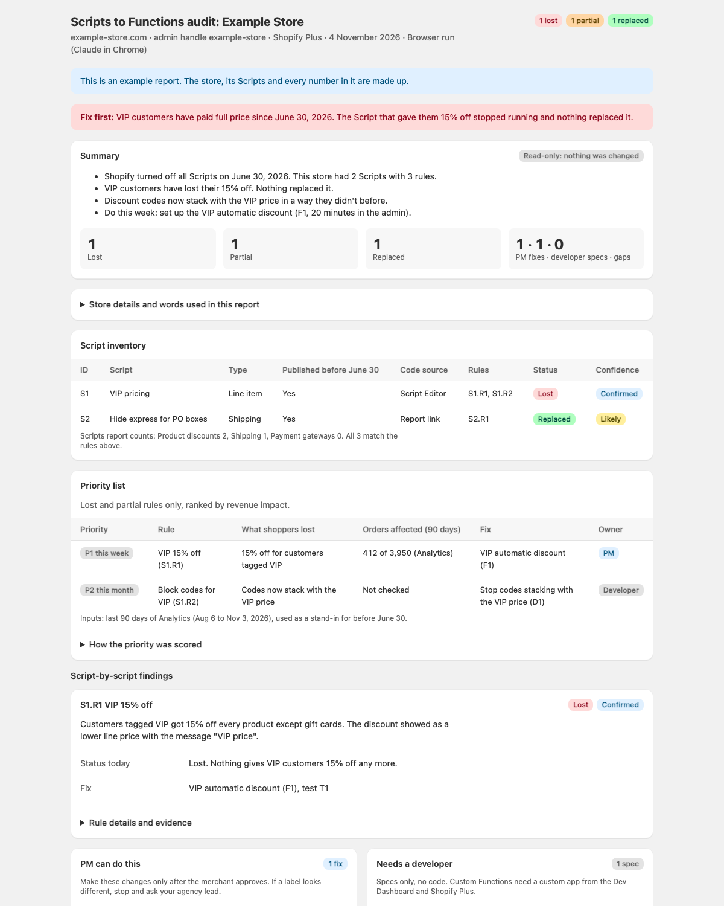

# scripts-to-functions-audit

A Claude skill for agency project managers. Shopify switched off every Shopify Script on June 30, 2026. Checkout kept working, but the discounts, shipping rules and payment rules those Scripts applied stopped without any error. This skill audits one store at a time: it finds each Script, explains what it did in plain English, checks the live admin to see whether anything replaced it, and writes one report with the fixes.

**Who it's for:** agency PMs and merchants with Shopify Plus stores that used Scripts. No technical skill needed.

**What it needs:** a staff or collaborator login for the store, already signed in in Chrome, and the Claude in Chrome extension. Without Chrome, it walks you through exporting the Scripts report and copying a few admin pages instead.

**What it never does:** it never changes the store, never signs in or asks for passwords, never adds to cart or places an order, never recommends third-party apps, and never writes or deploys code.

## Install

### Claude app (no technical setup)

1. Download [scripts-to-functions-audit.zip](https://github.com/ShahzDevAventures/scripts-to-functions-audit/releases/latest/download/scripts-to-functions-audit.zip).
2. In Claude, open **Settings → Capabilities** and turn on **Code execution and file creation** (newer layouts call it **Create and edit files**).
3. Open **Customize → Skills**, click **+**, then **Create skill → Upload a skill**, and choose the file. Check that the skill is switched on.
4. Install the Claude in Chrome extension from the Chrome Web Store and connect it. The skill uses it to read the store in your own browser. Without it, the skill guides you through a manual version instead.
5. Start a new chat.

On a Team or Enterprise plan, an owner first turns on code execution and Skills under **Organization settings → Plugins & skills → Policy**, and can add the skill for everyone in the organization.

### Claude Code

```bash
npx skills add ShahzDevAventures/scripts-to-functions-audit
```

Or clone it: `git clone https://github.com/ShahzDevAventures/scripts-to-functions-audit ~/.claude/skills/scripts-to-functions-audit`

## Use it

Say: **"Run the Scripts to Functions audit for example-store.com"** (use your store's address).

Claude confirms the store, then works one step at a time and asks one question at a time. It tells you before each page it reads. Plan for about an hour for a store with several Scripts; a store that never had Scripts takes a few minutes and gets a one-page "nothing to migrate" report.

## What you get

Two files with the same content:

- `{admin-handle}-scripts-to-functions-audit-{date}.html`: the report to read, styled like the Shopify admin. In the Claude app it opens in the chat as a private artifact.
- `{admin-handle}-scripts-to-functions-audit-{date}.md`: the same report in Markdown, for tickets.

The summary and this week's fixes come first and read in about five minutes. Then: the Script inventory, a priority list ranked by revenue impact, Script-by-script findings with evidence, **PM can do this** (native settings, click by click), **Needs a developer** (specs for custom Shopify Functions, no code), gaps, a test-checkout checklist, store-wide warnings, things the PM must check, a coverage check, sources, and the original Script code for reference.

## Sample report

This is a report for a made-up store, so you can see the output before you run it. [Open the full sample](https://shahzsiddiqui.vercel.app/skills/samples/scripts-to-functions-audit) in your browser. It is the same file as `references/report-template.html`.



The summary from that sample:

> **Fix first:** VIP customers have paid full price since June 30, 2026. The Script that gave them 15% off stopped running and nothing replaced it.
>
> - Shopify turned off all Scripts on June 30, 2026. This store had 2 Scripts with 3 rules.
> - VIP customers have lost their 15% off. Nothing replaced it.
> - Discount codes now stack with the VIP price in a way they didn't before.
> - Do this week: set up the VIP automatic discount (F1, 20 minutes in the admin).

## How it works

Each Script is split into rules (one condition, one effect). Each rule gets a status: **Lost** (nothing replaces it), **Replaced**, **Partial** (a replacement exists but differs), or **Never ran** (for example an unpublished draft). Every finding carries a confidence label: **Confirmed**, **Likely** or **Unverified**, and anything unverified becomes a check for the PM.

Fixes come from a map of 46 Script patterns (24 line item, 13 shipping, 9 payment): a native Shopify setting where one exists, otherwise a developer spec for a custom Shopify Function (custom Functions need Shopify Plus). Shopify-built apps such as Checkout Blocks appear only as labelled optional alternatives. Third-party apps are never recommended.

## Limits to know

- Shopify doesn't document the Scripts report's CSV columns or whether Script code can still be opened after June 30, 2026. The skill reads what is there and falls back to the report's descriptions, marking those findings Likely.
- Read-only is enforced by the skill's instructions. Shopify has no view-only staff permission for Discounts, Shipping or Checkout, so use an account the merchant is comfortable with.
- Facts were verified against Shopify's documentation on 2026-11-04. Shopify changes these pages often; re-check every quarter.

## Files

- `SKILL.md`: the procedure, safety rules and writing rules.
- `references/intake-browser.md` and `references/intake-manual-export.md`: how Claude reads the store, with Chrome or without.
- `references/script-reading-guide.md`: turning Ruby Scripts into plain-English rules.
- `references/status-verification.md`: how each rule is judged lost, replaced or partial.
- `references/replacement-map.md`: native fixes, Function APIs, plan limits, gaps and store-wide warnings.
- `references/priority-rubric.md` and `references/test-checklists.md`: ranking and test checkouts.
- `references/output-template.md` and `references/report-template.html`: the report content and its look.
- `references/sources.md`: every Shopify source, with the date it was checked.
- `docs/sample-report.png`: the screenshot in this README. It is not part of the skill and is left out of the zip.

## Author

Built by Shahz Siddiqui (https://github.com/ShahzDevAventures).

## License

MIT, see [LICENSE](./LICENSE).
